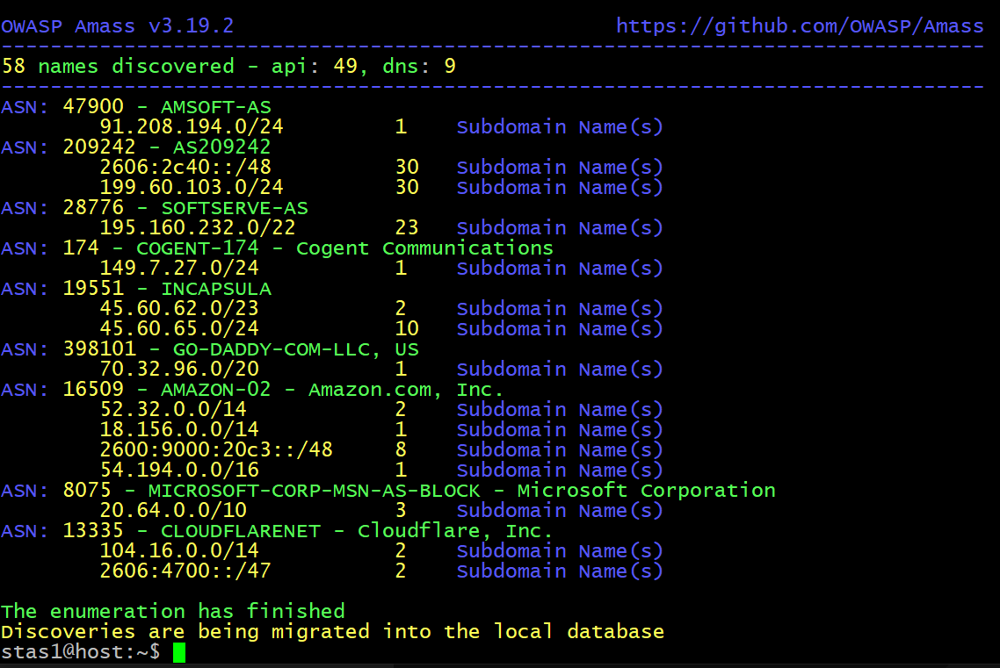
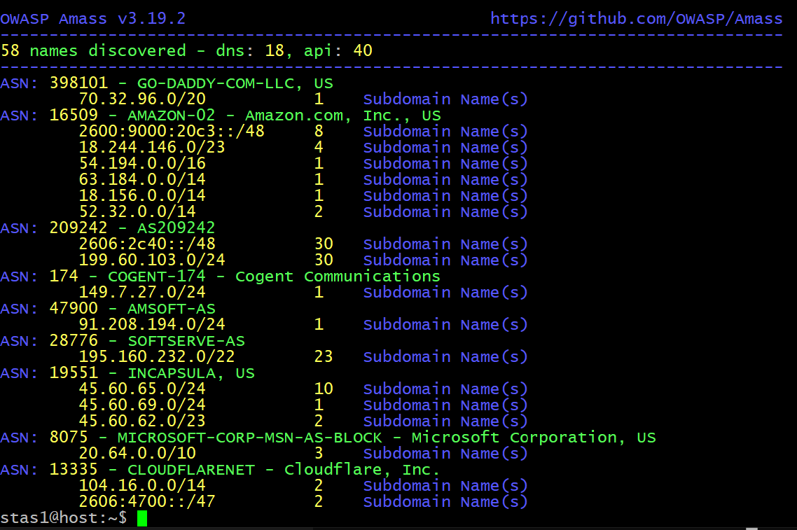
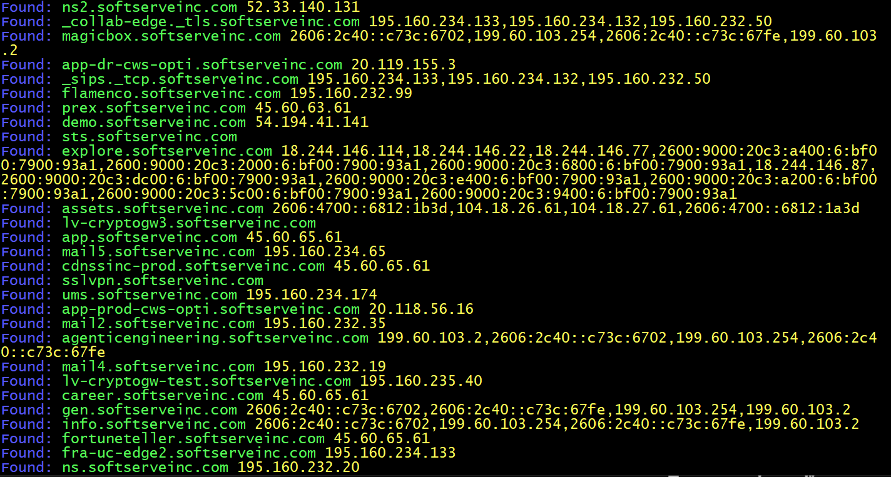
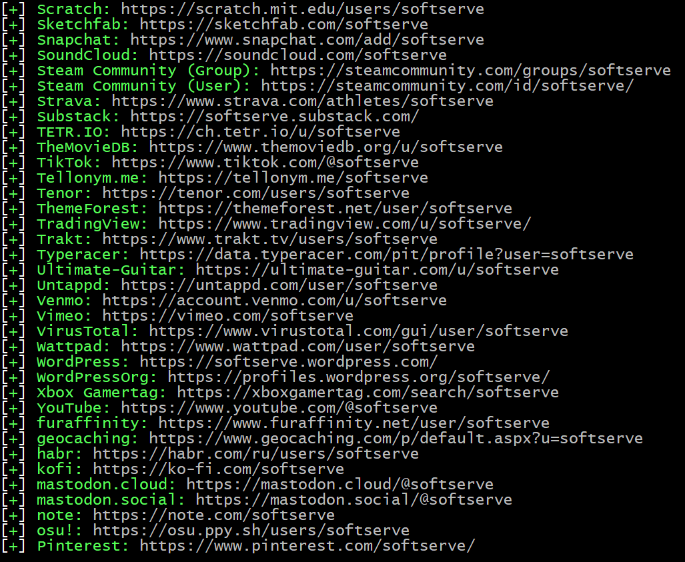
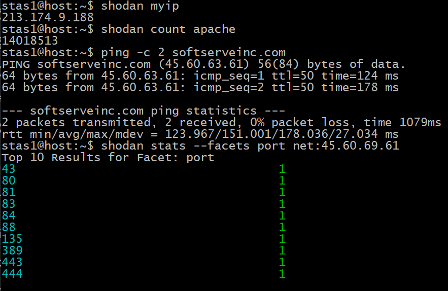

# Звіт з практичної роботи: Зовнішня розвідка та OSINT (Amass, Sherlock, Shodan)

**Виконавець:** Станіслав Петрів  
**Цільовий домен:** `softserveinc.com`  

---

## 1. Сканування та розвідка домену за допомогою Amass

У ході роботи було виконано перерахування субдоменів, аналіз автономних систем (ASN) та трекінг змін за допомогою утиліти **Amass**.

* **Перерахування субдоменів (Enum):**
  Інструмент зібрав 58 імен через джерела DNS та API[cite: 4]:
  [cite: 4]

* **Робота з локальною базою даних Amass (DB):**
  Перегляд збережених результатів та структури ASN цільової компанії[cite: 3]:
  [cite: 3]

* **Відстеження субдоменів (Track):**
  За допомогою команди трекінгу виявлено актуальні субдомени та прив'язані IP-адреси[cite: 5]:
  [cite: 5]

---

## 2. Пошук цифрового сліду за допомогою Sherlock

За допомогою утиліти **Sherlock** було здійснено перевірку наявності акаунта з нікнеймом `softserve` на понад 300 платформах[cite: 6]. Знайдені активні профілі успішно виведено та зафіксовано[cite: 6]:

[cite: 6]

---

## 3. Аналіз інфраструктури за допомогою Shodan

За допомогою утиліти **Shodan** виконано перевірку зовнішньої IP-адреси, загальної кількості сервісів за запитами та сканування відкритих портів цільового ресурсу (`softserveinc.com`)[cite: 2]:

[cite: 2]

---

## Висновок
Під час виконання практичної роботи було успішно освоєно базові інструменти пасивної та активної розвідки:
1. За допомогою **Amass** побудовано карту субдоменів та мережевих підмереж ASN.
2. За допомогою **Sherlock** досліджено присутність заданого нікнейма на популярних веб-ресурсах.
3. За допомогою **Shodan** проаналізовано відкриті мережеві порти цільового хоста.